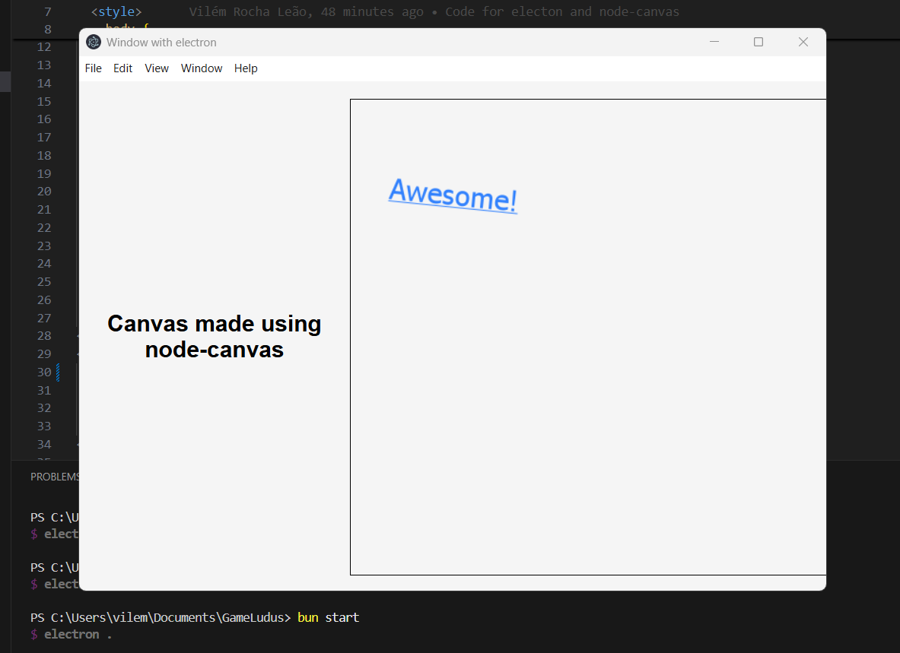

# GameLudus 👾
### v0.0.3

GameLudus is a powerful library designed for developers looking to create engaging 2D games using Çb, a custom programming language. With its seamless integration of canvas and Electron, GameLudus aims at simplifying game development while making it an enjoyable experience.

### Ludus stands for pleasure and is also related to training and learning, which are the main goals of this library!

## Features 🛠️
- **Seamless Integration**: A robust connection between canvas and Electron for smooth game performance.

## Upcoming Features ⏰
- **User-Friendly API**: Easy-to-use functions for beginners and advanced developers alike.
- **Extensible**: Designed with future expansion in mind, allowing for the addition of new functionalities.
- **Window and Sprite Management**: Create customizable game windows and dynamic sprites.
- **Advanced Rendering**: Efficiently render textures and animation.
- **Collision Detection**: Implement accurate collision detection for interactive gameplay.
- **Keyboard Input Handling**: Read and respond to keyboard inputs for player controls and actions.
- **Sound output**: Possibility of playing sound effects from .mp3 and .ogg files.

## Screenshots 🖼️


## Getting Started 🚀
Download the GameLudus files and place `gameLudus.ts` (located in `./src`) into Çb’s ./libs directory. Then, in `./source/runtime/environment.ts` import the library file with the correct path, and add it to the availableLibs object:

``` TS
    import * as gameLudus from "../../../libs/gameLudus";

    type NativeLib = Record<string, (...args: any[]) => any>;

    const availableLibs: Record<string, NativeLib> = {
        gameLudus: gameLudus.default,
    };
```

Then in your Çb code just add `import("gameLudus")`.

## License 📄
This project is licensed under the MIT License - see the `LICENSE` file for details.

### Conclusion
We welcome contributions from the community! Feel free to open issues or submit pull requests on GitHub. Let's create amazing games together with GameLudus!